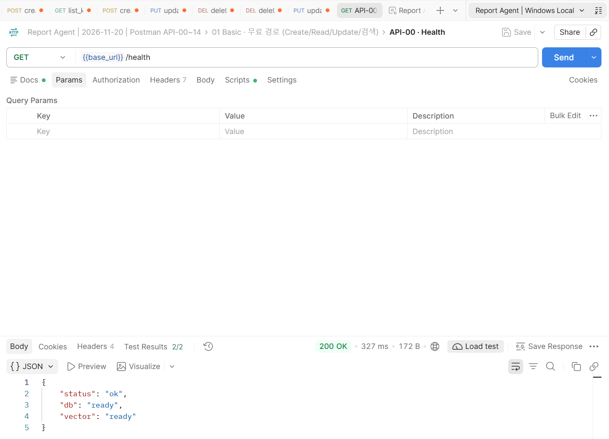
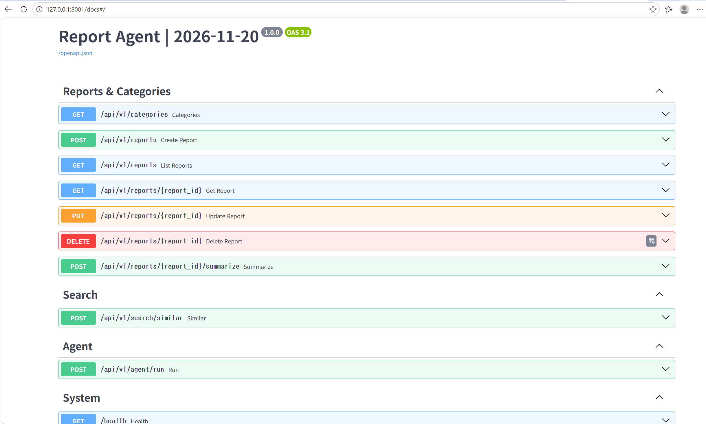

## 설정 및 첫 연결

### API-00 · Health
`GET {{base_url}}/health`  
아래와 같이 결과 확인 



## 카테고리·ID·제목 조회 완성

### API-01 · 카테고리 6건
`GET {{base_url}}/api/v1/categories`  
200, items 6개와 category_id/code/name/description 확인
```
{
    "items": [
        {
            "category_id": 1,
            "code": "EXPERIMENT",
            "name": "실험 결과 보고서",
            "description": "실험 조건과 성능 결과 기록"
        },
        {
            "category_id": 2,
            "code": "DAILY_WORK",
            "name": "일일 업무 보고서",
            "description": "하루 진행 업무와 장애 사항"
        },
        {
            "category_id": 3,
            "code": "RESEARCH_PLAN",
            "name": "연구 계획서",
            "description": "연구 목적과 실험 일정"
        },
        {
            "category_id": 4,
            "code": "DATA_PROCESSING",
            "name": "데이터 처리 보고서",
            "description": "데이터 수집·정제·검증 결과"
        },
        {
            "category_id": 5,
            "code": "PROMPT",
            "name": "프롬프트",
            "description": "프롬프트 정의 및 버전 이력"
        },
        {
            "category_id": 6,
            "code": "MEETING",
            "name": "회의록",
            "description": "회의 안건과 결정 사항"
        }
    ]
}
```

### API-03 · 시드 보고서 ID 조회
`GET {{base_url}}/api/v1/reports/{{seed_report_id}}`  
200, `seed_report_id=1`의 title/content/author/overview/details 확인
```
{
    "report_id": 1,
    "category_code": "EXPERIMENT",
    "title": "클래스 가중치 적용에 따른 소수 클래스 재현율 실험",
    "content": "실험 목적: 클래스 가중치 적용에 따른 소수 클래스 재현율 실험의 영향을 객관적으로 확인한다. 환경: 불균형 데이터 12:6:3. 방법: 동일한 데이터 분할과 기준 모델을 유지하며 class_weight 적용 전후 Macro-F1를 기록한다. 결과: 각 조건의 측정값을 표로 비교하고 성능 차이의 원인을 논의한다. 해석: 소수 클래스 누락 여부를 확인했으며, 반복 실험 전에는 수치 차이를 단정하지 않는다. 다음 조치: 동일 Seed와 테스트 데이터로 결과를 재검증한다.",
    "author": "박분석",
    "overview": "클래스 가중치 적용에 따른 소수 클래스 재현율 실험. 대상: 불균형 데이터 12:6:3. 핵심 접근: class_weight 적용 전후 Macro-F1. 확인해야 할 사항: 소수 클래스 누락 여부. 관련 자료와 결론을 추적할 수 있도록 요약한다.",
    "details": {
        "experiment_date": "2026-11-02",
        "hypothesis": "클래스 가중치 적용에 따른 소수 클래스 재현율 실험에서 비교 조건을 통제하면 차이가 나타날 것이다.",
        "result_summary": "class_weight 적용 전후 Macro-F1를 기준으로 비교하고 소수 클래스 누락 여부를 재확인한다."
    },
    "revision": 1,
    "index_status": "pending",
    "created_at": "2026-11-19T00:00:00Z",
    "updated_at": "2026-11-19T00:00:00Z"
}
```

### API-04 · 제목 검색
`GET {{base_url}}/api/v1/reports?title=%EA%B0%80%EC%A4%91%EC%B9%98&limit=20&offset=0`  
200, `title=가중치`의 items/total/limit/offset 확인

```
{
    "items": [
        {
            "report_id": 137,
            "category_code": "PROMPT",
            "title": "가중치 변경 실험 결과 정리",
            "revision": 1
        },
        {
            "report_id": 46,
            "category_code": "DAILY_WORK",
            "title": "검색어 가중치 테스트 케이스 정리",
            "revision": 1
        },
        {
            "report_id": 14,
            "category_code": "EXPERIMENT",
            "title": "가중치 초기화가 학습 수렴에 미치는 영향",
            "revision": 1
        },
        {
            "report_id": 1,
            "category_code": "EXPERIMENT",
            "title": "클래스 가중치 적용에 따른 소수 클래스 재현율 실험",
            "revision": 1
        }
    ],
    "total": 4,
    "limit": 20,
    "offset": 0
}
```

### 입력 오류: 존재하지 않는 ID 404
`GET {{base_url}}/api/v1/reports/999999999999`  
404, REPORT_NOT_FOUND. 정상 데이터를 읽는 것과 미존재를 구분

```
{
    "error": {
        "code": "REPORT_NOT_FOUND",
        "message": "요청한 보고서를 찾을 수 없습니다.",
        "details": {}
    }
}
```
## E5 연결 및 보고서 등록

### API-02 · 새 실험 보고서 생성
`POST {{base_url}}/api/v1/reports`  
원본 Body로 한 번 Send. 201, revision=1, index_status=ready. 

```
{
    "report_id": 181,
    "category_code": "EXPERIMENT",
    "title": "외부 충격 적용 모델 실험 Postman 신규 보고서",
    "author": "실습생",
    "revision": 1,
    "index_status": "ready",
    "embedding_model": "intfloat/multilingual-e5-small"
}
```

### API-03 · 방금 생성한 보고서 조회
`GET {{base_url}}/api/v1/reports/{{created_report_id}}`  
200. title/content/author/overview/details가 방금 보낸 입력과 일치하는지 자동 테스트와 응답을 확인

## 수정 및 삭제 완성

### API-05 · 보고서 전체 수정
`PUT {{base_url}}/api/v1/reports/{{created_report_id}}`  
개발 확인용 created_report_id=D를 유지하고 원본 PUT을 보냅니다. 200, 직전보다 revision 1 증가, 개요 변경 시 embedding_updated=true 확인

```
{
    "report_id": 181,
    "revision": 2,
    "index_status": "ready",
    "embedding_updated": true
}
```

### API-03 · 수정 후 저장값 재조회
`GET {{base_url}}/api/v1/reports/{{created_report_id}}`  
200, PUT 입력과 실제 저장값 일치. updated_contract를 이용하는 자동 비교가 통과해야 한다.

```
{
    "report_id": 181,
    "category_code": "EXPERIMENT",
    "title": "가중치 실험 Postman 수정 완료",
    "content": "새로운 검증 결과를 반영하였다. 학습 데이터의 클래스 수 분포를 점검한 후 Macro-F1을 다시 계산하였다. 이전 실험과 조건을 맞추어 재현성을 확인했다.",
    "author": "실습생",
    "overview": "수정된 실험: 클래스 불균형 가중치 변경 후 Macro-F1을 다시 비교하고 검증한 보고서",
    "details": {
        "experiment_date": "2026-11-20",
        "hypothesis": "재현율 개선 여부 재검증",
        "result_summary": "조건 일치 후 Macro-F1 비교 완료"
    },
    "revision": 2,
    "index_status": "ready",
    "created_at": "2026-11-20T07:38:23.731610Z",
    "updated_at": "2026-11-20T07:44:28.642577Z"
}
```

### 삭제 응답
204 No content, JSON 값은 비어있다.

## 전체 색인 및 Hybrid 검색 완성

### 전체 인덱스 생성 
```
python scripts/index_overviews.py
```

### API-07 · Hybrid 검색
`POST {{base_url}}/api/v1/search/similar`  
200, `query=가중치`의 관련 보고서 1건. 

```
{
    "status": "found",
    "query": "가중치",
    "best_match": {
        "report_id": 1,
        "title": "클래스 가중치 적용에 따른 소수 클래스 재현율 실험",
        "category_code": "EXPERIMENT",
        "overview": "클래스 가중치 적용에 따른 소수 클래스 재현율 실험. 대상: 불균형 데이터 12:6:3. 핵심 접근: class_weight 적용 전후 Macro-F1. 확인해야 할 사항: 소수 클래스 누락 여부. 관련 자료와 결론을 추적할 수 있도록 요약한다.",
        "keyword_match": true,
        "cosine_similarity": 0.7868
    }
}
```

### API-07 · 관련성이 낮은 질의
`POST {{base_url}}/api/v1/search/similar`  
입력값
```
{
  "query": "화성의 낙타 전용 미용실",
  "category_code": null,
  "keyword_limit": 20,
  "semantic_limit": 20
}
```

결과
```
{
    "status": "found",
    "query": "화성의 낙타 전용 미용실",
    "best_match": {
        "report_id": 45,
        "title": "테스트용 기초 데이터 180건 검수",
        "category_code": "DAILY_WORK",
        "overview": "테스트용 기초 데이터 180건 검수. 대상: 종류별 30건 카운트. 핵심 접근: FK 누락 0건 확인. 확인해야 할 사항: 본문 품질 점검. 관련 자료와 결론을 추적할 수 있도록 요약한다.",
        "keyword_match": false,
        "cosine_similarity": 0.7908
    }
}
```
`status`는 found로 나오지만, 엉뚱한 질의에 답변도 동떨어진 결과가 나오는 것을 확인할 수 있다. `keyword_match`도 false로 보고된다. 코사인 유사도가 그럴 듯하게 보이더라도 사람의 검증과 판단을 통해 무비판적으로 수용하지 않는다.

## 실제 요약 및 Basic Agent까지 완성

  
LLM agent와 summarize 기능을 코드 작성 완료한 후 10개의 API 존재를 확인한다.

## 테스트 및 실행 설명

### 원본 계약 테스트
```
$ python -m pytest -q -m "not live"
............                                                                                                                                               [100%]
12 passed, 1 deselected in 0.51s
```

### 실제 DB 검사 실행
```
$ RUN_LIVE_TESTS=1 python -m pytest -q -m live
.                                                                                                                                                          [100%]
1 passed, 12 deselected in 0.59s
(.venv) 
```

## 최종 검증

### 생성 보고서 삭제
새로 작성했던 보고서 1건의 정리를 통해 전체 180건을 다시 맞춘다. pgAdmin에서 180건임을 다시 확인한다.

### 검증표
| API ID | 엔드포인트 | 설명 | 상태 코드 | 결과 |
| --- | --- | --- | --- | --- |
| API-00 | GET {{base_url}}/health | 상태 확인 | 200 | "status": "ok", "db": "ready", "vector": "ready" |
| API-01 | GET {{base_url}}/api/v1/categories | 카테고리 조회 | 200 | 6종의 카테고리 |
| API-03 | GET {{base_url}}/api/v1/reports/{{seed_report_id}} | 시드 보고서 ID 조회 | 200 | 11건 존재 확인 |
| API-04 | GET {{base_url}}/api/v1/reports?title=%EA%B0%80%EC%A4%91%EC%B9%98&limit=20&offset=0 | 제목 검색 | 200 | 제목에 가중치가 들어가는 결과들 확인 |
| API-02 | POST {{base_url}}/api/v1/reports | 새 실험 보고서 생성 | 201 | 새 보고서 생성 |
| API-03 | GET {{base_url}}/api/v1/reports/{{created_report_id}} | 방금 생성한 보고서 조회 | 200 | 조회 성공 |

### 미완성
최종 검증 과정을 수행하고 보고서를 작성하는 동안 제한 시간이 도래하여 완성하지 못함.
추가 시간을 투입하여 완성 예정.